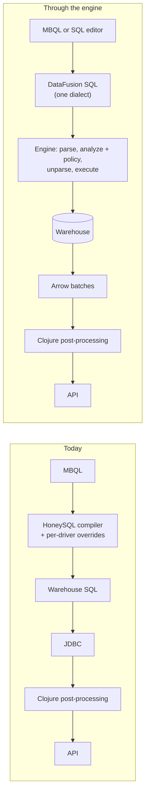
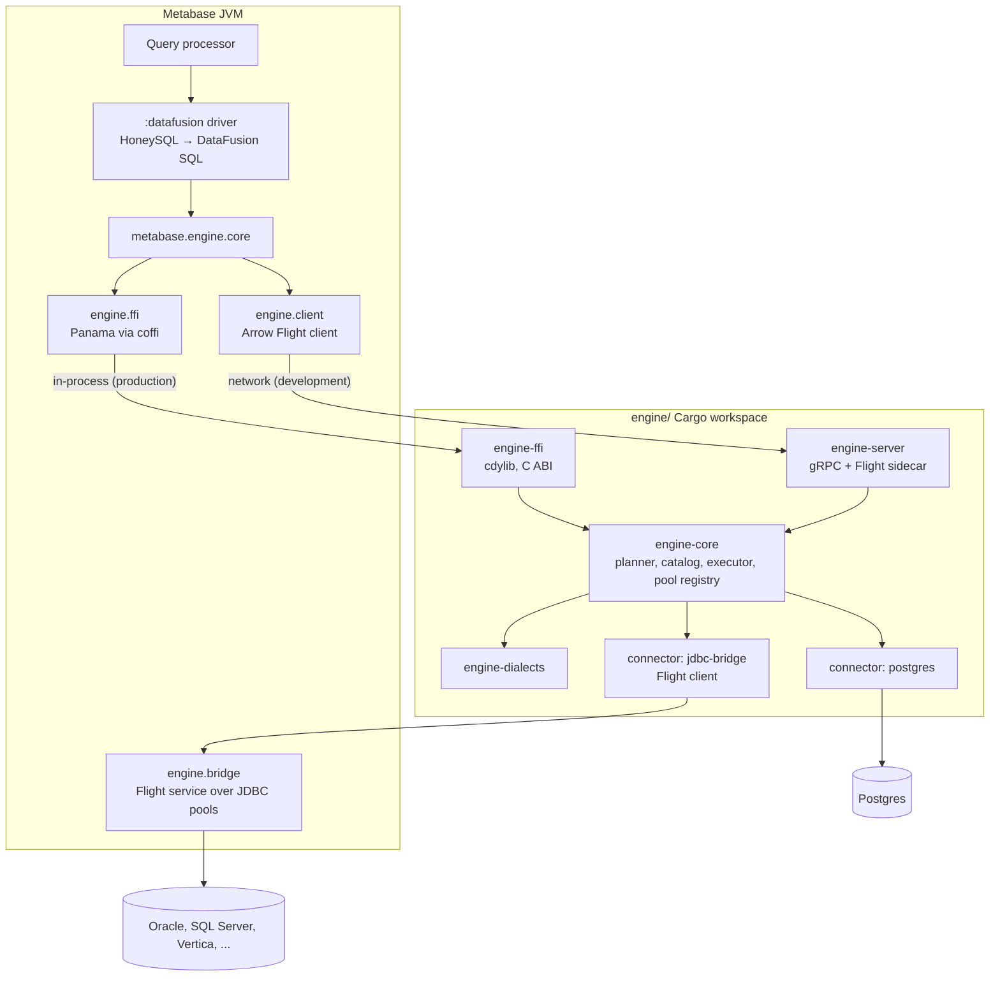

# DataFusion query engine

Status: design approved, implementation starting (September 2026). Postgres is the first warehouse.

## Summary

We're embedding an [Apache DataFusion](https://datafusion.apache.org) query engine in Metabase as a "meta database": one SQL dialect that the whole app targets, with the engine owning parsing, planning, plan-level security policy, catalog resolution, translation to each warehouse's dialect, warehouse connections, and Arrow-native results. MBQL becomes a structured subset of that one dialect, and the Rust side never sees MBQL. Nothing a person types reaches a warehouse except through an explicit, permission-gated passthrough. The first milestone is Postgres end to end, run in shadow mode against the existing JDBC path so the existing driver test suite is the oracle. What doesn't change: the query builder, MBQL, the API, and the post-processing pipeline, at least at first.

DataFusion terms used below: a **logical plan** is the tree DataFusion builds from SQL; **analyzer rules** run over it to resolve names and types; the **unparser** turns a plan back into SQL text using a per-warehouse **`Dialect`**; a **`TableProvider`** is how a catalog exposes a table; **Arrow record batches** are the columnar in-memory format results come back in; the **C Data Interface** lets two libraries share Arrow memory without copying.

## The problem today

### Dialect logic is spread across twenty drivers

MBQL compiles to SQL through a 2,400-line HoneySQL compiler plus per-driver overrides. The override counts show where the real work lives:

| Override                   | Count across drivers |
| -------------------------- | -------------------- |
| `sql.qp/date`              | 273                  |
| `sql.qp/->honeysql`        | 197                  |
| `sql.qp/datetime-diff`     | 97                   |
| `read-column-thunk`        | 58                   |
| `inline-value`             | 51                   |
| `unix-timestamp->honeysql` | 36                   |
| `cast-temporal-string`     | 34                   |

Every new expression, function, or temporal unit is a change in each of those places. Native SQL is always the warehouse's dialect, so nothing above the driver can reason about it, and Metabot needs fourteen per-dialect prompt files.

### Security is enforced by MBQL rewriting and warehouse privileges

Sandboxing is a preprocess middleware that rewrites the MBQL source table into a filtered subquery. It can only see MBQL. The docs say it plainly: groups with native query permissions can bypass row and column security. The real control for native SQL is the warehouse DB user's privileges. `setReadOnly` is a hint most drivers ignore outside a transaction, and native SQL runs through `Statement.execute`, which only fails afterwards if no result set came back, by which point a DML statement has committed. The only SQL firewall is the impersonation check, which parses with sqlglot, checks the top-level node, exempts admins, and runs regenerated SQL.

### Relational and statistical logic is reimplemented in Clojure

| Area                                          | Today                                                                   | Fit for the engine |
| --------------------------------------------- | ----------------------------------------------------------------------- | ------------------ |
| Fingerprinting, insights, binning             | First-10k-row sample, HyperLogLog and quantile sketches in the JVM      | Strong             |
| Metric arithmetic (`lib_metric`, ~6.5k lines) | Leaves run separately, hand-rolled hash join in Clojure                 | Strong             |
| Pivots, cumulative sums, remaps, composites   | Powerset of queries, running sums, per-row remaps, in-memory union/sort | Strong             |
| Linked filters                                | Hand-written FK graph search, cross-database constraints dropped        | Strong             |
| Query cache, model persistence, uploads       | Nippy blobs in the app DB; CTAS in the warehouse; whole file in memory  | Strong             |
| Native SQL analysis                           | sqlglot on GraalPy in-process, hangs under a timeout                    | Strong             |
| Workspaces (removed from master in July 2026) | Two-phase table remapping including a sqlglot rewrite of the final SQL  | Strong             |
| Instance analytics                            | 176 hand-written SQL view files across three app-DB dialects            | Strong             |
| Exports, notifications, actions               | Per-cell formatting, XLSX, per-row statements                           | Weak               |

Each strong-fit row is a join, window, sort, or aggregate the engine does natively, or a catalog lookup the engine does at plan time.

## What the engine is, and isn't

**It is:**

- One dialect in, warehouse SQL out. The app, the SQL editor, Metabot, and MBQL all produce DataFusion SQL.
- A plan-level policy layer. Row filters, column masks, and table visibility attach to scans at analysis time, so they apply to MBQL, native, and AI-generated SQL identically.
- The owner of the catalog. Metabase's own table and field metadata backs a session-scoped catalog. Workspace remapping, routing, and sandboxing become different views of that catalog.
- The owner of warehouse connections. Pools, session settings, cancellation, and sync run through Rust connectors.
- Whole-query pushdown. The entire plan is translated and executed in the warehouse. Constructs the warehouse can't run are rejected with a structured error naming the construct and the warehouse.

**It isn't:**

- A federation engine. Cross-warehouse joins stay disallowed, which removes plan splitting and most of the ecosystem's federation bugs.
- A place that computes over warehouse rows. Local execution is reserved for non-warehouse data (cache, uploads, Parquet, the app DB) and for bounded fallbacks where the remote input is already aggregated or limited.
- Aware of MBQL. Rust receives SQL plus a session context.

## Architecture

### Query path today versus through the engine



### Components



One Rust core, two thin front-ends. Production loads the shared library into the JVM through Java 25's foreign function API. Development runs the same core as a sidecar, because a native library can't be hot-reloaded into a running REPL. The boundary is message-shaped (JSON requests and responses, Arrow streams for data), so both transports carry identical payloads.

### One MBQL question through the engine

```mermaid
sequenceDiagram
  participant QP as Clojure QP
  participant DRV as :datafusion driver
  participant ENG as Engine (Rust)
  participant PG as Postgres
  QP->>DRV: MBQL query
  DRV->>DRV: compile to DataFusion SQL with $1 placeholders
  DRV->>ENG: execute(sql, params, session context)
  ENG->>ENG: parse → analyze (types, policy hook) → reject unsupported → unparse (Postgres dialect)
  ENG->>PG: BEGIN READ ONLY; SET LOCAL time zone / statement_timeout / role; SELECT ...
  PG-->>ENG: rows (binary protocol)
  ENG-->>DRV: Arrow batches over the C Data stream
  DRV-->>QP: column metadata + reducible rows
  QP->>QP: existing post-processing and API response
  Note over QP,PG: Cancel: QP closes canceled-chan → driver cancels the stream → engine fires the cancel token → Postgres cancels the statement
```

## Key mechanisms

### Session context

Every request carries: user id and attributes (for policy), database id (scopes the catalog), workspace, report timezone, row limit, query origin (card, dashboard, ad hoc, API) for the audit comment, and a cancel handle. Parameter values travel separately as typed JSON and bind as `$1` placeholders, never as inlined text.

### Catalog snapshots and identifier casing

Metabase pushes a snapshot of a database's tables and columns (with Arrow types and the raw database type) keyed by database id and catalog version. The engine swaps versions atomically; in-flight queries keep the snapshot they started with. Identifier normalization is off (`enable_ident_normalization=false`) so `"Orders"` keeps its case, which means the compiler always quotes identifiers using the snapshot's exact names.

### Analyze, then unparse, without the optimizer

The pushed plan goes through DataFusion's analyzer rules (name resolution, type coercion, and our policy rule) and then straight to the unparser. DataFusion's logical optimizer never runs on it. The warehouse has its own optimizer, and the optimizer's rewrites produce shapes the unparser handles badly; DataFusion issue #21066 documents exactly this on the Postgres dialect. The session is built with an empty optimizer rule list so an accidental `optimize()` is a no-op.

### Rejecting unsupported constructs, and the fix loop

Before unparsing, a walker rejects plan nodes and functions the target dialect can't express: semi and anti joins on Postgres, `UNNEST` where unsupported, extension nodes, and any scalar function outside the dialect's allowlist. The error names the construct and the warehouse, and telemetry on those errors decides what to fix next. Each fix is one of:

1. A dialect mapping or an upstream unparser fix, landed with a sqllogictest case.
2. A per-dialect rewrite rule when the warehouse genuinely lacks the construct, or a bounded local fallback, or it stays rejected.
3. A semantics-preserving rewrite (integer division, NULL in `concat`, collation) or a documented divergence.

Every fix ships with a CI test against the real warehouse.

### Pooling lives in the crate

A registry keyed by database id, connection role, and a hash of the connection details, behind a `Connector` trait. Postgres uses a socket pool; HTTP warehouses will use token caches and concurrency limits. Per query on Postgres: `BEGIN READ ONLY`, then `SET LOCAL` for time zone, statement timeout, and impersonation role, so read-only is real rather than a hint and settings die with the transaction. Cancellation uses the protocol-level cancel token. Metabase passes decrypted details on first use and invalidates on change. Pool stats surface in the metrics endpoint next to the c3p0 stats.

### The JDBC bridge

For warehouses without a trustworthy Rust driver, Metabase hosts a small Arrow Flight service that runs SQL on an existing JDBC pool with session settings and streams Arrow back. The Rust side is a Flight client, so it's a `Connector` like any other. It's reserved for a named list with exit criteria: Oracle until the official thin driver leaves beta, SQL Server until a maintained TDS crate earns trust, Vertica and Hive over Thrift unless ODBC proves better, and community JDBC drivers. Postgres and Snowflake never use it. The shadow-mode driver suite runs for bridged warehouses too.

### Errors map onto the QP's error types

Engine errors are JSON with a `kind` and an `error_type` that is the exact keyword from `metabase.query-processor.error-type`, so the Clojure side rethrows without translation. Every exported function catches panics and returns `internal_panic` rather than taking the JVM down.

## Pros and cons

| Area            | Benefit                                                                                                                                       | Cost                                                                                                                 | Mitigation                                                                                                         |
| --------------- | --------------------------------------------------------------------------------------------------------------------------------------------- | -------------------------------------------------------------------------------------------------------------------- | ------------------------------------------------------------------------------------------------------------------ |
| Architecture    | One dialect for MBQL, the editor, and Metabot; capability flags leave the UI; catalog, security, routing, and workspaces become one mechanism | A second language and runtime in the product; a boundary to design and keep stable                                   | Message-shaped API, one core with two thin transports, contract tests on both                                      |
| Maintainability | Dialect logic becomes `Dialect` implementations with a test harness; upstream carries Postgres, MySQL, Snowflake, BigQuery                    | The ported override logic still has to be written, in Rust, for the warehouses upstream lacks                        | Port one warehouse at a time with the existing driver suite as the oracle; patch-then-upstream, no long-lived fork |
| Performance     | Arrow end to end; results typed once by the plan schema; bounded fallbacks in the engine instead of Clojure loops                             | Every result crosses an FFI boundary; planning cost per query; two memory budgets in one container                   | Zero-copy C Data stream; flat-memory streaming as a milestone gate; engine memory pool sized alongside the heap    |
| Security        | Statement type by construction, functions by registry, tables by catalog; table-level permissions on native SQL for the first time            | The unparser's literal rendering is the new injection boundary; passthrough remains unrestricted                     | Bind parameters everywhere; an escaping test suite per dialect; passthrough behind its own permission              |
| Operability     | Sync, execution, and cancellation through one stack per database; uniform limits and timeouts                                                 | Native library per platform inside the jar; JVM native-access flags; a native crash is a JVM crash                   | CI build matrix; panic containment at every export; the sidecar as an escape hatch for isolation                   |
| Testing         | sqllogictest in federated mode gives per-warehouse construct coverage; shadow mode diffs old and new paths on real data                       | Two suites to keep green; the driver suite gets a second CI dimension                                                | Allowlisted failures that ratchet down; tag JDBC-only tests explicitly                                             |
| Team skills     | A contributor relationship with an active Apache project                                                                                      | Rust competency required on the backend team; DataFusion releases every six to ten weeks with lockstep version bumps | Keep the Rust surface small and well-documented; one owner for upstream bumps                                      |

## Risks

Ranked by how much they could change the plan. Each names the milestone that retires it.

| #   | Risk                                                                                                                                                                | Likelihood | Impact | Mitigation                                                                                                                                      | Retired by |
| --- | ------------------------------------------------------------------------------------------------------------------------------------------------------------------- | ---------- | ------ | ----------------------------------------------------------------------------------------------------------------------------------------------- | ---------- |
| 1   | Unparser coverage on the MBQL corpus for Postgres: known open bugs drop `IGNORE NULLS`, emit DataFusion-only functions verbatim, and mishandle some subquery shapes | High       | High   | Golden corpus of Metabase-shaped queries; function allowlist per dialect; analyze-only pipeline avoids optimizer-induced shapes; upstream fixes | M2, M4     |
| 2   | Alpine image: our library needs a musl build, and Arrow Java's C Data helper ships glibc-only                                                                       | High       | Medium | `gcompat` on Alpine or switch production to the Ubuntu image; fallback to Arrow IPC over FFI with no second native library                      | M1 spike   |
| 3   | Semantic drift: the engine's answer differs from the warehouse's for integer division, NULL in `concat`, week numbering, regex flavor, time zones                   | High       | Medium | Semantics-preserving rewrites per dialect; sqllogictest federated harness; a stated product principle and release notes                         | M4 onward  |
| 4   | Connector breadth: Oracle, Vertica, Hive over Thrift, SQL Server, Databricks, and Athena have weak or no Rust drivers                                               | Certain    | Medium | JDBC bridge with exit criteria; ODBC bring-your-own for Vertica and Hive; ADBC as a per-warehouse lever                                         | M6         |
| 5   | Arrow Java version coupling with the BigQuery driver (18.3.0) and JDK 25 allocator flags                                                                            | Medium     | Medium | Pin all Arrow Java to 18.3.0; use the unsafe allocator, not Netty; run the uberjar conflict audit                                               | M1         |
| 6   | DataFusion release cadence and lockstep pins (datafusion, arrow, arrow-flight, tonic); ecosystem crates lag a major                                                 | Certain    | Low    | One owner for bumps; no dependency on lagging crates (table-providers is already excluded)                                                      | Ongoing    |
| 7   | Native crash coupling, tokio runtime lifecycle inside the JVM, sqlparser recursion on adversarial input                                                             | Medium     | High   | `catch_unwind` at every export, `recursive_protection`, blocking-thread planning with a large stack, idempotent shutdown, JVM shutdown hook     | M1, M3     |
| 8   | Memory: two budgets in one container; hash joins don't spill in DataFusion                                                                                          | Medium     | Medium | No local compute over warehouse rows; engine memory limit set from config; flat-memory streaming gate                                           | M3         |
| 9   | Feature regressions where JVM fallbacks (cumulative sums, pivot powerset, per-row remaps) become unsupported on warehouses lacking the feature                      | Medium     | Low    | Bounded fallbacks in the engine for exactly these; feature flags already gate most of them                                                      | Later      |
| 10  | Dev-loop friction: native changes need a JVM restart                                                                                                                | Certain    | Low    | The development sidecar                                                                                                                         | M1         |
| 11  | musl allocator performance and cross-compilation of TLS crates                                                                                                      | Medium     | Low    | `mimalloc` as global allocator; rustls with the ring backend; `cargo-zigbuild`                                                                  | M6         |
| 12  | Rust capacity and upstream discipline: forks drift (Spice is 172 commits ahead of upstream federation on a private DataFusion fork)                                 | Medium     | Medium | Short-lived `[patch.crates-io]` with an upstream PR for every patch; dropped on the next bump                                                   | Ongoing    |

## Considered and discarded

| Option                                                 | Why not                                                                                                                                                                                                                                                                                                          |
| ------------------------------------------------------ | ---------------------------------------------------------------------------------------------------------------------------------------------------------------------------------------------------------------------------------------------------------------------------------------------------------------- |
| DuckDB as the engine                                   | No plan-level hooks reachable from the JVM, no row-level security, one fixed dialect with per-scanner hand-rolled SQL generation, a C++ extension API version-locked to each patch release, and zero community connectors built for musl. Better only for bolting cross-database joins onto the current pipeline |
| Apache Calcite                                         | Pure JVM, but cross-source execution falls back to generated Java with no spilling, and no Arrow                                                                                                                                                                                                                 |
| `apache/datafusion-java` binding                       | Version 0.1.0 exposes "run SQL, collect results", not the catalog, analyzer, and unparser hooks this design needs; Java table providers have no pushdown; the API is declared unstable                                                                                                                           |
| JNI instead of Panama                                  | No advantage on Java 25, more boilerplate, same native-access restriction                                                                                                                                                                                                                                        |
| JDBC-callback table provider as the MVP execution path | It hides the problems that decide feasibility: type mapping to Arrow, auth and tunnels in Rust, packaging, connector performance, sync. Kept only as the explicit bridge for named warehouses                                                                                                                    |
| `datafusion-federation` as a dependency                | Self-labelled alpha; accepts every parent filter as pushed down and drops predicates silently; runs after decorrelation; no capability gate; six integration tests; the one production user runs a fork 172 commits ahead. Without cross-warehouse joins we don't need plan splitting at all                     |
| `datafusion-table-providers`                           | Pinned to DataFusion 54 and arrow 58, incompatible with 55; nanosecond timestamps; errors on unknown types. Borrow decoder ideas only                                                                                                                                                                            |
| Restricting the unparser to MBQL-shaped plans          | SQL is the full surface; MBQL is the subset                                                                                                                                                                                                                                                                      |
| A Metabase-owned plan-to-SQL renderer                  | Forfeits upstream dialects and fixes; it's the HoneySQL compiler rebuilt over DataFusion plans                                                                                                                                                                                                                   |
| WASM-hosted planner inside the JVM                     | Real sandboxing win, but DataFusion's WASM build targets the browser: single-threaded, no filesystem, no zero-copy Arrow. Kept as an experiment                                                                                                                                                                  |
| Postgres-wire or Flight SQL "sidecar as a database"    | The engine would need its own connector for every warehouse, and Metabase would talk to it like a warehouse, losing the "give me the SQL" entry point transforms and view-SQL need                                                                                                                               |
| SQL Server as the second warehouse                     | The pure-Rust TDS crate is unmaintained with an open advisory for server-triggerable pre-auth panics; its continuation is weeks old; the ADBC driver is closed source                                                                                                                                            |
| Local compute over warehouse rows by default           | Arbitrary user SQL plus a pushdown miss means an unbounded warehouse scan, the worst failure mode for cost and time                                                                                                                                                                                              |
| ADBC as the general connector strategy                 | Blocking driver manager; the Snowflake, BigQuery, Spark, and Trino drivers moved out of the Apache project into a third-party foundry with mixed licensing. Kept as a per-warehouse lever                                                                                                                        |
| ODBC as the general strategy                           | Needs a system ODBC manager and vendor drivers per platform. Kept for Vertica and Hive, mirroring today's bring-your-own-jar model                                                                                                                                                                               |

## Short-term plan

Milestones for the Postgres MVP, each with its gate:

1. **Rust skeleton, callable from the JVM and via sidecar.** `plan_and_unparse` over a static catalog returns Postgres SQL both in-process and over gRPC; a forced panic returns a structured error; the Alpine spike decides C Data versus IPC.
2. **Catalog snapshots and the `:datafusion` driver.** Real tables from the app DB; MBQL compiled to DataFusion SQL through a new HoneySQL dialect; a golden corpus of 50+ Metabase-shaped queries unparses to Postgres.
3. **Execution, Arrow back, routing, cancellation.** A per-database `query-engine` setting routes MBQL through the engine; a million-row query streams with flat memory; cancel reaches `pg_stat_activity` within a second; the type matrix passes.
4. **Driver suite in shadow mode.** The Postgres driver tests run with `MB_QUERY_ENGINE=datafusion`; a shadow corpus diffs both paths with zero differences; the sqllogictest federated harness runs in CI against an allowlist.
5. **Sync, stats, invalidation.** Sync runs through the engine's pool; pool stats appear in metrics; a details change drains the old pool.
6. **JDBC bridge, packaging, CI.** Bridged Postgres passes the execute tests; the uberjar carries every native variant; both Docker images start.

## Long-term plan

- Snowflake next, then the connector tiers: MySQL, ClickHouse, Mongo (ready); BigQuery, Redshift, Trino, Druid, Databricks (viable); Oracle, SQL Server, Athena via the bridge until their Rust paths mature; Vertica and Hive via ODBC.
- Policy enforcement (row filters, column masks, table visibility) in the analyzer rule, replacing MBQL sandboxing, with the impersonation firewall retired.
- Native SQL in the engine dialect by default; warehouse passthrough as a table function with its own permission, parse-checked and run on a read-only, timed-out, impersonated connection.
- Workspaces as session-scoped catalog resolution, so one instance can serve many workspaces.
- Post-processing (formatting, limits, remaps, pivots, cumulative sums) as engine operators over Arrow; then Arrow-native caching and Parquet materialization for persisted models and uploads.
- Dialect port order: Postgres, MySQL, Snowflake, BigQuery exist upstream; SQL Server, Redshift, ClickHouse, Athena, Presto, Databricks, Spark, Vertica, Druid to write. Retire each HoneySQL compiler as its dialect lands.
- Metabot on one dialect with planner-based validation; instance-analytics views written once; lineage and validation from the logical plan instead of sqlglot.

## Status and lessons so far

Milestones 0 through 5 are on the `hackathon-datafusion` branch: the Rust workspace, the Clojure module, the `:datafusion` driver, catalog snapshots, the Postgres connector, execution through the engine with Arrow results, routing by the `query-engine` database setting (`jdbc`, `datafusion`, or `shadow`), the sidecar transport, shadow-mode comparisons, and sync through the engine's pool (the Postgres driver's own metadata SQL, run over a raw execution path that skips planning). Milestone 6 has the packaging half (an `:engine` uberjar build step, a Rust CI workflow, the toolchain wiring) and the JDBC bridge: a loopback Arrow Flight service Metabase hosts over its own JDBC pools, with a Rust connector on the engine side, so warehouses without a Rust driver run through the engine's planner and the driver's connection. Bridged Postgres answers the execute tests like native Postgres.

The running gap measure is the query processor's own test suite run through the engine against Postgres (`MB_QUERY_ENGINE=datafusion`, the informational step in `.github/workflows/engine.yml`). Thirty-two namespaces (771 tests) went from 128 failing to 3. Two of the three are adversarial join aliases containing a backslash before a quote, which the engine rejects with a structured error rather than mis-escape. The third is DataFusion's SQL planner dropping `ORDER BY` inside a derived table that has no `LIMIT`, which one nested-query test relies on Postgres honoring; that is a semantics difference to communicate, not a bug to fix. Sixteen further namespaces (pivots, parameters, models, nested fields, JSON aliases, time series, metadata) pass after native pivot tables were enabled. The whole Postgres driver suite (3,650 tests tagged `:mb/driver-tests`) went from 356 failing to 3 in four rounds (the two rejected aliases and the subquery `ORDER BY`; nine enterprise transform merge tests also fail, but identically on the plain JDBC path, because rows from earlier runs accumulate in their shared dataset): the first round was one bug (engine pools for deleted test databases were never closed and exhausted the server's connections), the rest were type edges (`money`, `inet`, `bit`, `bytea`, enums, columns promoted by upload appends). Tests that assert JDBC mechanics rather than results (pool acquisition errors, statement cancellation, connection diagnostics, persisted-cache tables in the SQL) carry `^:mb/jdbc-only` and are excluded from the measure. Things that were gaps and are now closed the same way each time: a construct the two dialects spell differently gets an engine UDF the dialect renders (`mb_cast`, `mb_bytes_to_text`, `mb_at_time_zone`), and a plan shape the unparser gets wrong gets a small rewrite before unparsing (merging nested projections; aliasing the columns a sort-then-project drops).

Lessons that changed the design in small but important ways:

- **Nothing engine-side runs on a JVM thread.** Polling a future with `block_on` runs it on the caller's stack, and the unparser's recursion on a nested plan overflowed a JVM thread's stack, which took the JVM down with an illegal-instruction signal. Every entry point now spawns the work on the engine's worker threads (16 MB stacks) and the JVM thread only waits. Result streams are driven by a worker task and handed to the C Data reader through a bounded channel, and anything reachable from an Arrow C-stream callback catches panics and never needs a tokio context.
- **Stages compile as subqueries, not CTEs.** Metabase's per-stage CTEs reuse the same name in nested scopes. Postgres accepts that; DataFusion doesn't.
- **Only the intersection dialect goes in.** The unparser emits DataFusion function names verbatim, so the `:datafusion` compiler uses forms valid in both DataFusion and Postgres, and rewrites for warehouse-specific spellings belong in the Rust dialect, not the Clojure compiler. The Postgres dialect so far casts `substr` positions to `INTEGER` (DataFusion coerces them to `BIGINT`) and parenthesizes array subscripts (`(regexp_match(...))[1]`).
- **The plan's types are not the warehouse's types.** A bare `$1` in a select list plans as `Null`, DataFusion's `AVG` is `Float64` where Postgres returns `numeric`, and `int4` is not `Int64`. The schema cast takes the warehouse's type for `Null` plan columns, the catalog carries the warehouse type as a hint, and `numeric` is decoded from the wire format into `Decimal128(38, 10)` so 38 significant digits survive (more than ten fractional digits round).
- **Sync is a feature flag away from silently doing nothing.** `describe-fields` on the engine driver did the right thing when called directly, but sync asks `database-supports?` first and fell back to a `describe-table` the driver doesn't have; every table synced zero fields and the only test asserted the sync returned something. Sync tests now compare table, field, and FK counts against a JDBC sync of the same warehouse.
- **Shadow mode is a sampler, not a mirror.** Reruns go through a two-thread executor with a bounded queue, run as the user who asked (so permissions and sandboxing apply), are not userland queries (no extra `QueryExecution` rows), and never log row values.
- **Databases the connector can't fully honor stay on JDBC.** SSH tunnels, custom certificates, client auth, and JDBC-only options are checked in routing, not silently dropped by the connector. So does a database routed to an engine this process can't start: the jar without the library, or the Alpine image until a musl build ships.
- **An engine UDF is how the plan says what the SQL surface can't.** `CAST(x AS TIME)` plans as a nanosecond time the unparser can't spell, and `x AT TIME ZONE 'z'` plans as a bare cast that loses the zone. `mb_to_time` and `mb_at_time_zone` are registered in every session, typed by their return-type function (which can look at the argument types, so `AT TIME ZONE` flips between zoned and wall-clock like Postgres), never executed, and rendered by each dialect. The same mechanism carries the warehouse's own type name as Arrow field metadata so the JVM can restore `uuid` and `timetz`, which Arrow has no types for.
- **An analyzer rule can be in the way.** DataFusion's analyzer rewrites `grouping(...)` into bit operations over an internal grouping-id column, which no warehouse SQL can express; the session runs the analyzer without that rule and the warehouse's own `GROUPING(...)` does the work, so native pivot tables (one `GROUPING SETS` query) go through unchanged.
- **Caching the catalog stamp broke sync.** A fresh sync registers an empty catalog, and a ten-second stamp cache then trusted it while sync's own sample queries ran. The driver now retries once with a fresh snapshot when the engine reports a table it doesn't know; the cache stays, because two app-DB aggregates per query was the alternative.
- **A routed database holds two pools.** The engine's pool sits next to the JDBC pool, which sync's fingerprinting and field values, actions, and shadow reruns still use, so a warehouse with a tight connection budget can see twice the connections from one instance. The JDBC bridge avoids this (it is the JDBC pool); for native connectors the pool size setting is shared by both until sync and the rest move over.
- **The sqllogictest harness catches what the driver suite can't.** `engine-slt` runs the same `.slt` files against DataFusion executing locally (the oracle: what a query _means_ in the engine's dialect) and against the engine planning, unparsing and executing on Postgres; a difference is a semantic drift no error would have reported. Its first run over five files found three: integer aggregates and `extract` came back as `numeric` (the schema cast let a "wider" warehouse type win everywhere, a rule meant only for catalog columns an upload had promoted; it now applies only to columns carrying the catalog's type name), `regexp_like` had no Postgres rendering (now `~` and `~*`), and a table named bare in the SQL went to the warehouse bare, where the connection's search path, not the catalog's default schema, would resolve it (scans are now qualified). `cargo run -p engine-slt -- update` regenerates expectations from the oracle, `check` runs both sides, and the suite is a cargo test that CI requires Postgres for.
- **The bridge is the driver's own execution path behind a Flight ticket.** It reuses the JDBC driver's connection options, statement and parameter handling, column metadata and row readers, so a bridged warehouse answers exactly as it does over JDBC, and the engine only adds the planner in front.

## Open questions

- Should the SQL editor default to the engine dialect with passthrough as an opt-in, or the reverse during migration?
- How do we communicate "Metabase gives the engine's answer regardless of warehouse" where it changes existing results?
- Production base image: the Ubuntu variant, or `gcompat` on Alpine?
- Does sync-time row sampling for fingerprinting route through the engine in the MVP? Default: no.
